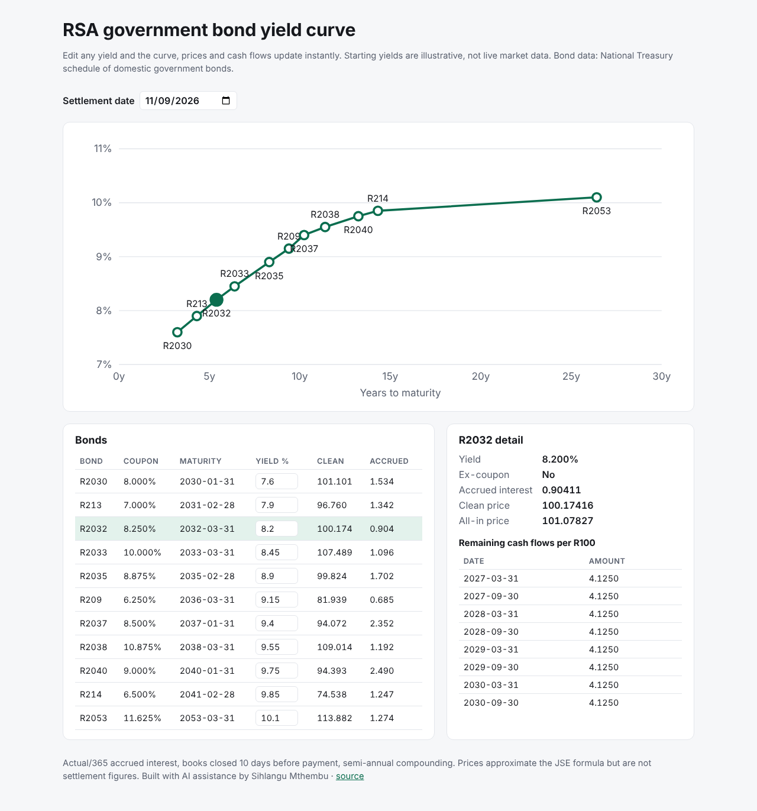

# yield-curve-web


An interactive website for South African government bonds, built with **React and TypeScript** (Vite). Edit any bond's yield and the yield curve, prices, accrued interest and cash-flow schedule update instantly.

**Live site:** https://sihlangu-mthembu.github.io/yield-curve-web/



## Features

- **Yield curve chart** drawn in plain SVG (no chart library): click a point to select a bond.
- **Bond table** with editable yields, clean prices and accrued interest for 11 RSA fixed-rate bonds.
- **Detail panel**: ex-coupon status, accrued interest, clean and all-in price, and every remaining cash flow.
- **Settlement date picker**: matured bonds drop off the curve automatically.
- **Live API cross-check**: the deployed site is built with `VITE_API_URL` set to the live [rsa-bond-api](https://rsa-bond-api.onrender.com/docs), so a button compares the browser's price with the server's (the free API host may take a minute to wake up).
- Responsive layout and automatic dark mode.

## How it fits together

| Project | Role |
| --- | --- |
| [rsa-bond-calculator](https://github.com/sihlangu-mthembu/rsa-bond-calculator) | Python library: the bond maths |
| [rsa-bond-api](https://github.com/sihlangu-mthembu/rsa-bond-api) | FastAPI service exposing the library over HTTP |
| **yield-curve-web** | This site: a TypeScript port of the maths, so it runs entirely in the browser, plus an optional call to the API |

The TypeScript port is tested against the Python library's numbers (for example R2032 at 8.9% on 9 November 2026: clean price 97.22148), so the two implementations agree.

## Run it

```bash
npm install
npm run dev          # http://localhost:5173/yield-curve-web/
npm test             # 7 Vitest tests
npm run typecheck    # TypeScript compiler
npm run lint         # oxlint
npm run build        # production build in dist/
```

Every push to `main` runs the type check, linter, tests and build, then deploys to GitHub Pages.

## Notes

Starting yields are **illustrative, not market data**. Conventions: actual/365 accrued interest, books closed 10 days before a payment, semi-annual compounding. Prices approximate the JSE's official formula but are not settlement figures.

## About

Built with AI assistance (Claude) by Sihlangu Mthembu. See `WALKTHROUGH.md` for a file-by-file explanation.
